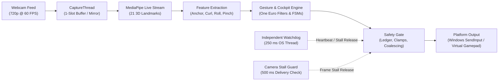
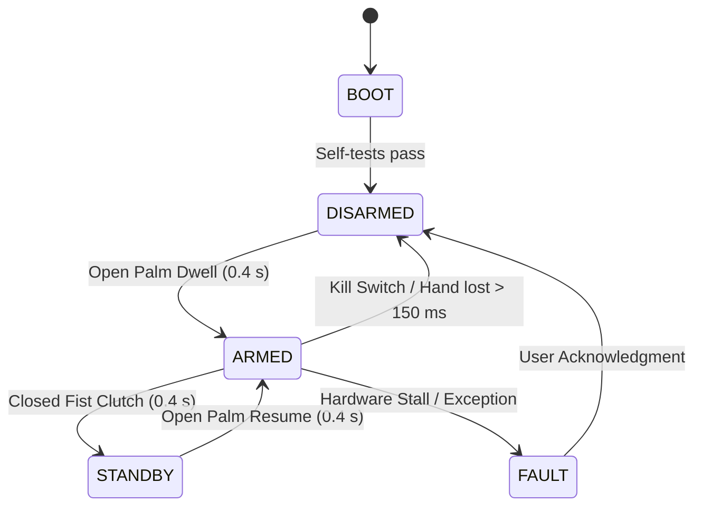

# ✈ Aileron

<div align="center">

[](https://github.com/NandiVardhan2007/Aileron/releases)
[](https://www.python.org/)
[-brightgreen.svg?style=flat-square)](#platform-support)
[](docs/benchmarks.md)
[](docs/TESTING.md)
[](docs/SAFETY.md)
[](#security--privacy)

**Fly your cursor. Steer your simulator. Zero physical wear — just your hands.**

*Aileron transforms any standard USB or integrated webcam into an ultra-low-latency, fail-safe touchless controller for desktop navigation and vehicle simulation on Windows 10 and 11.*

[Quick Start](#quick-start) • [Modes & Controls](#operation-modes) • [Safety Architecture](#fail-safe-safety-architecture) • [Configuration](#configuration--custom-profiles) • [Documentation](#documentation-index)

</div>

---

## Overview

An *aileron* is the flight control surface on an airplane's wing that controls roll. Tilt your hand, and Aileron does the same for your workstation: using high-performance computer vision powered by Google's MediaPipe 21-point hand perception model, Aileron maps natural human hand mechanics into high-precision, sub-millimeter **OS pointer events** and high-fidelity **analog simulator gamepad inputs**.

All signal processing, One Euro adaptive filtering, kinematics modeling, and intent translation run **100% locally in user space**. No camera frames, images, or biometric telemetry ever touch a network or persist to disk.



---

## Key Features

- **Sub-Millimeter Pointer Tracking:** Active-region desktop mapping with non-linear gamma curves, multi-monitor / DPI virtual-desktop scaling, and dynamic click-freeze drift suppression.
- **Micro-Pinch Gesture FSMs:** State-machine driven left click, drag-and-drop, double click, right click, and middle click with anatomical palm-size normalization and hysteresis bands.
- **Fluid Joystick Scrolling & Zooming:** V-sign continuous scroll with velocity power curve and two-hand atomic pinch zoom (`Ctrl` + wheel).
- **Cockpit Vehicle Simulation:**
  - **Yoke Profile (Cars/Trucks):** True two-hand steering wheel angle calculation, calibrated lock-to-lock limits, expo curves, and dual index-extension pedal mapping (right index throttle, left index brake).
  - **Handlebar Profile (Motorbikes/Bicycles):** Single-hand wrist roll steering ($\pm 35^\circ$) with multi-source throttle (thumb curl, index extension, or wrist twist) and off-hand brake.
- **Enterprise-Grade Safety Guardrails:** Fail-closed exception handling, 250 ms dedicated OS watchdog thread, 150 ms hand-lost drop, 1.0 s pre-flight neutral hold, 200 ms axis ramp-in, and global hotkey kill switch (`Ctrl+Alt+Esc`).
- **Low-Power Camera Idle:** Automatically releases physical webcam handles when disarmed without preview, preserving battery life and user privacy.
- **Accessibility & Tremor Suppression:** Built-in Stability Mode with expanded hysteresis and Dwell-Click (hover-to-click) for motor-impaired users.

---

## Platform Support

Aileron is engineered and optimized exclusively for **Windows 10 and Windows 11 (64-bit)**:

| Component | Technology | Description |
|---|---|---|
| **Pointer Mode** | Native Win32 `SendInput` (ctypes) | High-speed mouse motion, clicks, drags, scroll, and zoom. |
| **Cockpit Mode** | ViGEmBus Virtual Xbox 360 Gamepad | True analog steering, throttle, and brake emulation for racing/flight sims. |
| **Keyboard Fallback** | `KeyboardPwmGamepad` | Software PWM keyboard emulation if virtual gamepad driver is not installed. |
| **Global Emergency Stop** | Win32 `RegisterHotKey` | OS-level global kill switch bound to `Ctrl+Alt+Esc`. |
| **Safe Dry-Run** | `NullBackend` | Full telemetry and HUD overlay with zero OS input injection. |

---

## Quick Start

### 1. Prerequisites

- **Operating System:** Windows 10 or Windows 11 (64-bit).
- **Python:** Version 3.11 or 3.12 (64-bit).
- **Webcam:** 720p @ 30 FPS minimum (720p @ 60 FPS recommended for lowest latency).
- **Package Runner:** [uv](https://astral.sh/uv) (recommended) or standard Python `pip`.

### 2. Installation

Clone the repository and synchronize dependencies:

```cmd
git clone https://github.com/NandiVardhan2007/Aileron.git
cd Aileron

:: Using uv (recommended)
uv sync

:: Or using standard python venv
python -m venv .venv
.venv\Scripts\activate
pip install -e .
```

### 3. Running Aileron

Turnkey launcher scripts are provided:

```cmd
:: 1. Safe dry-run with live HUD overlay (zero OS input injection)
run.bat

:: 2. Interactive gamepad axis and trigger viewer
uv run aileron --gamepad-test

:: 3. Arm live control (starts DISARMED; show open palm for 0.4s to arm)
run.bat --live
```

---

## Operation Modes

Aileron operates as a finite-state machine across three primary session modes:



### 1. Pointer Mode (Desktop Navigation)
- **Cursor Motion:** Move your primary hand open-faced across the calibrated active region. The cursor follows the scale-invariant anchor midpoint between the index and middle metacarpophalangeal joints ($L_5, L_9$).
- **Left Click:** Tap thumb tip to index fingertip quickly (< 300 ms).
- **Drag & Drop:** Pinch and hold thumb tip to index fingertip (> 300 ms). Cursor locks to prevent click-jitter. Release pinch to drop.
- **Double Click:** Double tap thumb to index fingertip within 350 ms.
- **Right Click:** Pinch thumb tip to middle fingertip.
- **Middle Click:** Pinch thumb tip to ring fingertip.
- **Continuous Scroll:** Extend index and middle fingers in a **V-sign** (peace sign); move hand up or down. A smooth non-linear velocity curve maps displacement to wheel lines.
- **Pinch Zoom:** Form pinches with both hands simultaneously; spread hands apart to zoom in, bring them together to zoom out (`Ctrl` + wheel).

### 2. Cockpit Mode (Vehicle Simulation)
Switch between Pointer and Cockpit mode at any time using the **Shaka 🤙 dwell gesture** (0.8 s hold) or CLI flag `--profile yoke`:
- **Yoke Steering:** Hold both hands in front of the camera as if gripping a steering wheel. The angular vector between left and right index knuckles ($L_9$) controls the virtual gamepad left stick (`LX`), complete with deadzone, expo curve, and One Euro low-pass filtering.
- **Pedal Throttle & Brake:** Extend your right index finger forward to apply throttle (`RT`); extend your left index finger forward to apply brake (`LT`).
- **Button Pinch Combos:**
  - Shift Up: Right thumb-to-ring pinch (`RB`).
  - Shift Down: Left thumb-to-ring pinch (`LB`).
  - Handbrake: Right thumb-to-pinky pinch (`X`).
  - Horn / Look Back: Left thumb-to-pinky pinch (`Y`).
- **Throttle Toggle Protection:** For flight and vehicle safety, mode-switching is strictly blocked while throttle exceeds 30% (`SAFE-07`).

---

## Fail-Safe Safety Architecture

Aileron is designed around defense-in-depth principles outlined in `docs/SAFETY.md`:

| Invariant | Protection Mechanism | Behavior |
|---|---|---|
| **SAFE-01** | Global Kill Switch | Pressing `Ctrl+Alt+Esc` or running `aileron --panic` disarms the system within < 1 ms. |
| **SAFE-02** | Hand-Lost Neutralization | If the primary hand leaves camera view for > 150 ms, all held keys, mouse buttons, and gamepad triggers immediately release. |
| **SAFE-03** | Startup Disarmed | System always launches in `DISARMED` state. User must perform an intentional open-palm dwell to arm. |
| **SAFE-04** | Hardware Watchdog | An independent OS thread monitors the control loop heartbeat. If a stall > 250 ms occurs, all outputs are forcefully released. |
| **SAFE-05** | State Transition Release | Entering `STANDBY`, `DISARMED`, or `FAULT` emits guaranteed atomic `ReleaseAll()` intent. |
| **SAFE-06** | Desktop Bounds Clamping | Cursor coordinates are hard-clamped to virtual desktop boundaries. Negative or infinite coordinates are rejected. |
| **SAFE-07** | Event Flood Defense | Discrete events are rate-limited to 50/tick; analog motion intents are coalesced to the latest sample. |
| **SAFE-08** | Fail-Closed Error Boundary | Any unhandled exception triggers immediate transition to `FAULT`, drops all inputs, and writes diagnostics to the black box. |

---

## Pre-Flight Calibration & Profiles

### Interactive Calibration Wizard
To customize Aileron for your specific arm span, hand size, and desk geometry, run the interactive pre-flight calibration wizard:

```bash
uv run python -m aileron.calibration.wizard --profile racing
```

The wizard guides you through four quick steps:
1. **Neutral Angle:** Hold your hands in a natural, relaxed resting position.
2. **Lock-to-Lock Range:** Rotate hands to your maximum comfortable steering angle (e.g. $\pm 45^\circ$).
3. **Trigger Extension:** Relax and fully extend index fingers to establish pedal baselines.
4. **Live Verification:** Test responsive axes on a visual test grid before saving.

Profiles are saved in TOML format to `config/profiles/<NAME>.toml` with automatic schema version migrations (`CFG-03`).

---

## CLI Reference

```text
Usage: aileron [OPTIONS]

Options:
  --backend [auto|null|windows|linux|vgamepad|keyboard_pwm]
                                  Output backend implementation (default: auto).
  --profile NAME                  User profile name from config/profiles/<NAME>.toml.
  --debug                         Enable live OpenCV preview window and telemetry chips.
  --no-hud                        Run headless without preview overlay window.
  --replay FILE                   Replay pre-recorded or synthetic JSONL landmark session.
  --record FILE                   Record live hand landmarks to JSONL format.
  --gamepad-test                  Run interactive ASCII terminal axis and trigger visualizer.
  --panic                         Send an emergency release signal to all active instances.
  --print-config                  Print fully resolved configuration in TOML format.
  --help                          Show this message and exit.
```

---

## Standalone PyInstaller Packaging

To compile a standalone binary distribution for Windows or Linux:

```bash
# Verify assets and build specification (Dry run)
uv run python tools/build_installer.py --dry-run

# Build binary package into dist/aileron
uv run python tools/build_installer.py --clean
```

---

## Security & Privacy

- **Zero Cloud Communication (`PRIV-01`):** No network sockets, HTTP clients, telemetry beacons, or external dependencies exist in the execution loop.
- **Zero Video Persistence (`PRIV-02`):** Video frames reside in volatile RAM only long enough to extract 21 geometric points. No images, video clips, or photos are ever written to disk.
- **Opt-In Landmark Black Box:** In the event of a safety fault, a circular in-memory buffer can dump the last 10 seconds of numerical landmarks and intents to a local JSONL file for debugging.

---

## Documentation Index

For in-depth architectural specifications and mathematical proofs, consult the project documentation:

| Document | Description |
|---|---|
| [docs/PRD.md](docs/PRD.md) | Product Requirements Document, user personas, success metrics. |
| [docs/ARCHITECTURE.md](docs/ARCHITECTURE.md) | System decomposition, concurrency model, data flow diagrams. |
| [docs/INTERFACES.md](docs/INTERFACES.md) | Protocol definitions, dataclass schemas, backend contracts. |
| [docs/SIGNAL_PROCESSING.md](docs/SIGNAL_PROCESSING.md) | One Euro adaptive filter math, gamma curves, kinematics. |
| [docs/GESTURES.md](docs/GESTURES.md) | Complete gesture catalog, FSM states, timing thresholds. |
| [docs/COCKPIT_MODE.md](docs/COCKPIT_MODE.md) | Steering kinematics, pedal mapping, virtual gamepad drivers. |
| [docs/SAFETY.md](docs/SAFETY.md) | Hazard analysis (H01–H11), fail-safe design, hardware checklists. |
| [docs/CONFIGURATION.md](docs/CONFIGURATION.md) | Comprehensive parameter reference for `config/defaults.toml`. |
| [docs/TESTING.md](docs/TESTING.md) | Replay verification methodology, synthetic generator, benchmarks. |
| [docs/ROADMAP.md](docs/ROADMAP.md) | Milestone delivery log (M0 through M7) and v1.0 release criteria. |
| [HUMAN_TODO.md](HUMAN_TODO.md) | Mandatory human hardware sign-off checklist before real OS arming. |
| [KNOWN_ISSUES.md](KNOWN_ISSUES.md) | Hardware verification gaps and platform-specific driver notes. |

---

## License

Aileron is open-source software licensed under the **Apache License 2.0**.  
See [LICENSE](LICENSE) for details. (Third-party MediaPipe runtime is licensed under Apache-2.0).
