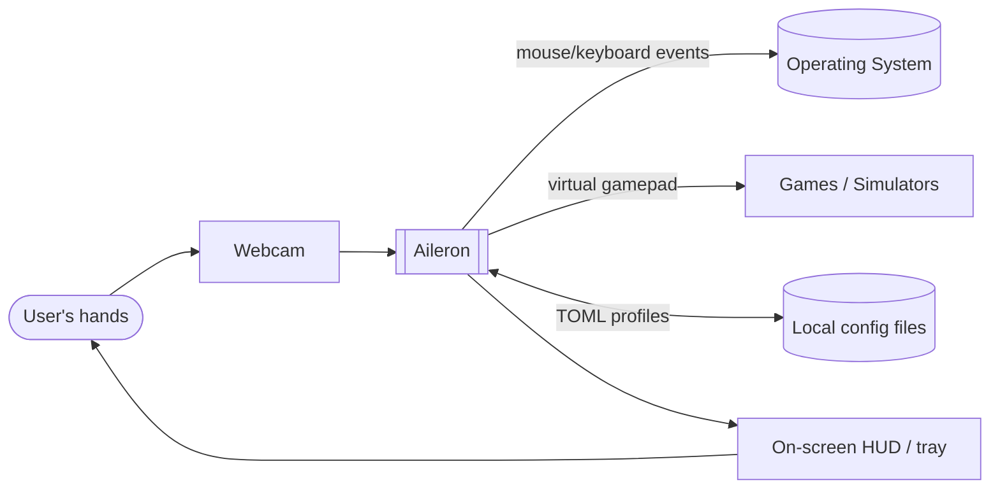
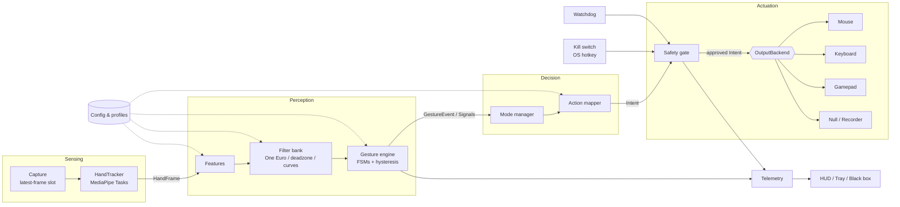
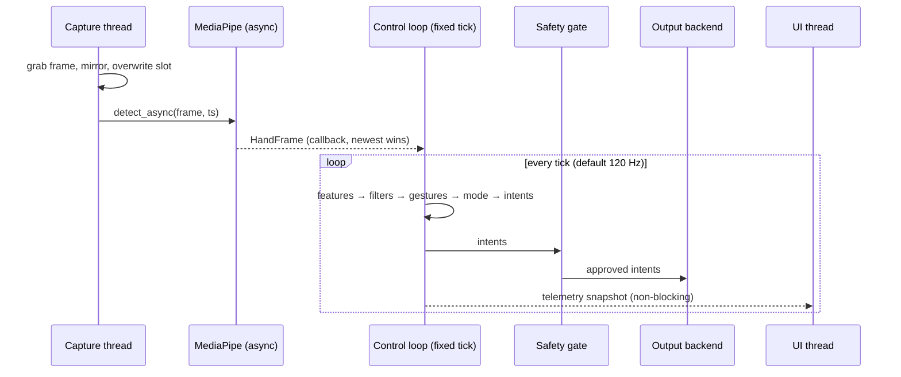
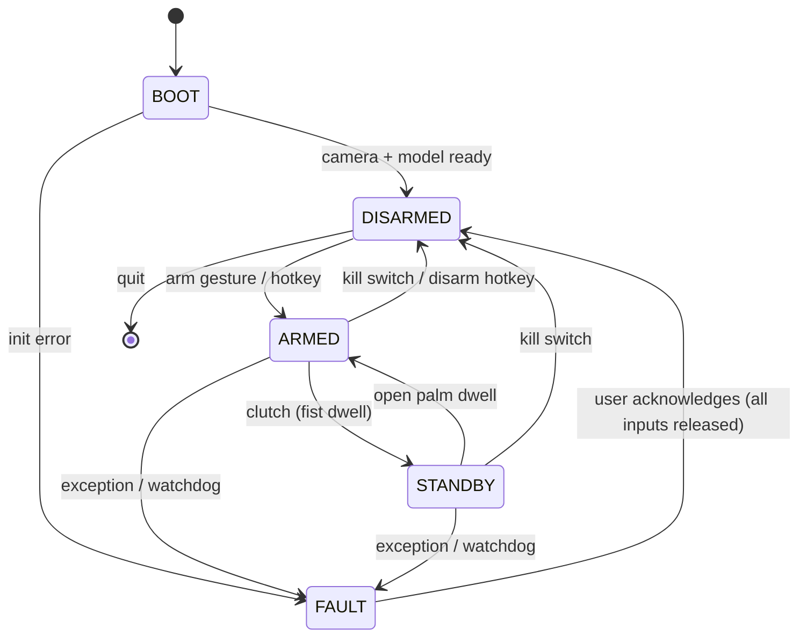
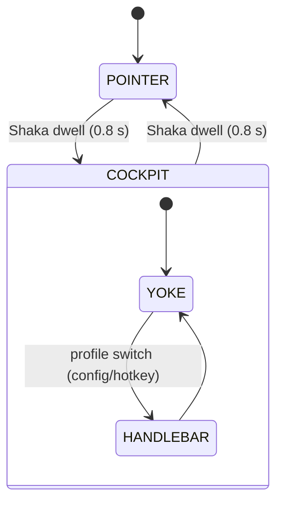
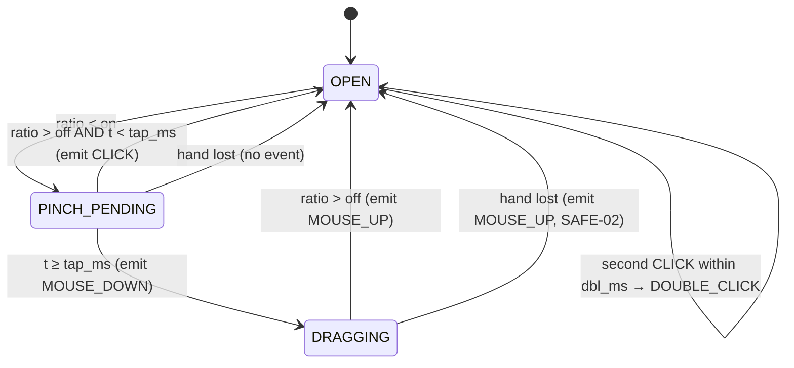
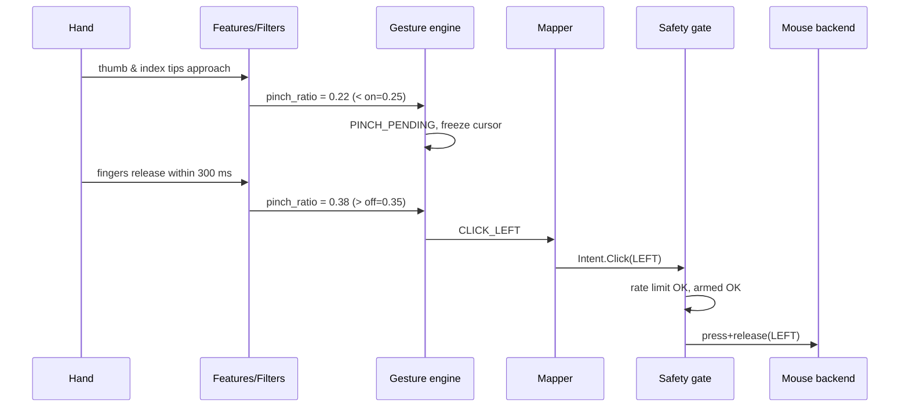

# System Architecture — Aileron

## 1. Context

Aileron is a local desktop application. No network services, no cloud. The OS sees Aileron as a normal
input device source; games see a standard gamepad.

## 2. Component view

### 2.1 Responsibilities and contracts
Full type definitions are in `INTERFACES.md`. Each stage consumes one immutable data type and produces
another, which keeps every stage unit-testable and replayable.

| Stage | Input → Output | State | Failure behavior |
|-------|----------------|-------|------------------|
| Capture | camera → `Frame` | latest frame only | Camera error → `FAULT`, neutralize |
| HandTracker | `Frame` → `HandFrame` | MediaPipe internal | No hand → `HandFrame(hands=[])` |
| Features | `HandFrame` → `Features` | none (pure) | NaN → mark hand invalid |
| Filters | `Features` → `FilteredFeatures` | per-channel filter state | Reset on hand loss |
| GestureEngine | `FilteredFeatures` → `GestureOutput` | FSM per gesture | Reset on hand loss |
| ModeManager | `GestureOutput` → routed output | mode, arm state | Invalid transition ignored, logged |
| ActionMapper | routed output → `Intent[]` | small | Unknown mapping → drop |
| SafetyGate | `Intent[]` → approved `Intent[]` | rate limiters, held-input ledger | Fails closed |
| OutputBackend | `Intent` → OS side effect | held-input ledger | Error → `release_all()` + FAULT |

## 3. Runtime and threading

- **Capture thread:** owns the camera; single-slot "latest frame" buffer; mirrors the frame once; stamps `monotonic_ns` at grab time (used for all latency measurement).
- **Inference:** MediaPipe `LIVE_STREAM` async callback; results delivered into a single-slot mailbox.
- **Control loop:** fixed-rate timer; reads the newest `HandFrame`; when no new frame has arrived it **extrapolates nothing** (holds last filtered values and ages them) so output cadence stays steady without inventing motion.
- **Watchdog thread:** monitors control-loop heartbeat; independent of the pipeline.
- **Kill-switch listener:** OS-level hotkey registered on its own thread.
- **UI:** separate thread/process, receives telemetry snapshots through a lossy queue; never blocks control.

## 4. Latency budget (targets; validate with benchmarks)

| Segment | Budget (ms) | Notes |
|---------|-------------|-------|
| Camera exposure + readout + USB | 20–30 | Largest unavoidable chunk; 60 fps cams help |
| Capture → inference start | ≤ 2 | Single-slot buffer, no queueing |
| MediaPipe inference | 6–12 | GPU delegate optional |
| Features + filters + gestures | ≤ 1 | Pure NumPy, preallocated |
| Control tick alignment | ≤ 8 | Half of 120 Hz tick on average ~4 |
| Safety gate + OS injection | ≤ 2 | Native `SendInput` / `uinput` |
| **Total (p95)** | **≈ 45–60** | Matches NFR-1/NFR-2 |

Latency is measured end-to-end with timestamps carried in every message (`t_capture_ns` → `t_emit_ns`) and
reported by `tools/plot_latency.py`. An optional LED/screen flash rig can validate the camera segment.

## 5. State machines

### 5.1 Session state

Output is only ever emitted in `ARMED`. Entering any other state calls `release_all()` first.

### 5.2 Active mode (while armed)

A mode change always passes through a neutral frame: `release_all()` → switch → HUD announcement.

### 5.3 Pinch (click/drag) FSM

### 5.4 Click sequence

## 6. Data model overview
`Frame` → `HandFrame` (0–2 `Hand`s, each with 21 landmarks + 21 world landmarks + handedness + confidence) →
`Features` (palm_size, curl[5], pinch ratios, wrist-line angle, palm normal, anchor) → `GestureOutput`
(discrete events + continuous signals) → `Intent` (`Move`, `Button`, `Scroll`, `Zoom`, `Axis`, `Trigger`,
`ReleaseAll`). Definitions in `INTERFACES.md`.

## 7. Error handling and degradation

| Condition | Detection | Response |
|-----------|-----------|----------|
| No hand / low confidence | `hands=[]` or conf < threshold | After `hand_lost_ms`: neutralize; HUD shows "searching" |
| Two hands when one expected | hand count | Pick primary hand (closest/largest; sticky); ignore the other |
| Hand re-enters frame | transition | Require re-engage dwell (0.3 s) before output resumes |
| Camera disconnect | read failure | FAULT, neutralize, HUD prompt, auto-retry with backoff |
| Control-loop stall | watchdog | `release_all()`, FAULT |
| Output backend error | exception | `release_all()` via fallback, FAULT |
| Gamepad driver missing | init error | Offer keyboard fallback; Pointer mode still works |
| Low light | mean luminance / confidence drop | HUD hint; increase smoothing optionally |

## 8. Platform matrix

| Capability | Windows | Linux | macOS |
|-----------|---------|-------|-------|
| Capture | OpenCV (MSMF/DShow) | OpenCV (V4L2) | OpenCV (AVFoundation) |
| Mouse/keyboard | `SendInput` (ctypes) or pynput | `uinput` (evdev) / X11; Wayland via uinput | Quartz `CGEvent` (needs Accessibility permission) |
| Virtual gamepad | `vgamepad` + driver | `uinput` gamepad | Not available → keyboard PWM fallback |
| Global hotkey | `RegisterHotKey` | X11 grab / evdev | `CGEventTap` (Input Monitoring permission) |
| Packaging | PyInstaller/Nuitka + signed installer | AppImage / pip | `.app` bundle (signed/notarized) |

## 9. Extensibility
- **Backends** implement `OutputBackend` and register via entry point group `aileron.backends`.
- **Gestures** implement `GestureDetector` and register via `aileron.gestures`; each declares its required features and config schema.
- **Profiles** are TOML files layered over defaults; a profile can enable/disable gestures and rebind actions.
- Future: per-application auto-switching profiles (foreground window detection).

## 10. Observability
- Structured logs (JSON lines) with levels; no PII; rotating files.
- Live metrics on HUD debug panel: capture FPS, inference ms, end-to-end latency p50/p95, dropped frames, hand confidence.
- **Black box:** optional ring buffer of the last ~10 s of landmark frames plus intents, dumped on FAULT or on demand. Landmarks only; stored locally; opt-in.

## 11. Security and privacy
Local-only processing; no network I/O in the pipeline; no video persistence; least privilege (only request OS
permissions actually needed); plugins load only from the user's local environment and run with the same
privileges as Aileron, so the plugin system is documented as trusted-code-only. Details in `SAFETY.md`.

## 12. Deployment and packaging
- Dev: `uv sync`. Release: PyInstaller (or Nuitka) one-folder build; model file bundled; Windows installer includes optional driver guidance (not silent driver installs).
- Versioned config schema with migrations; crash reports are local files the user can attach to an issue.
